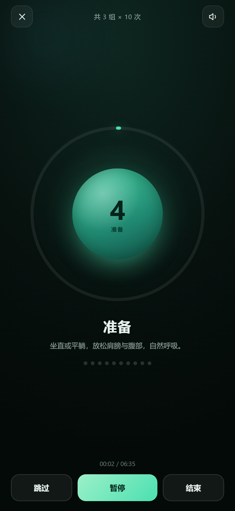
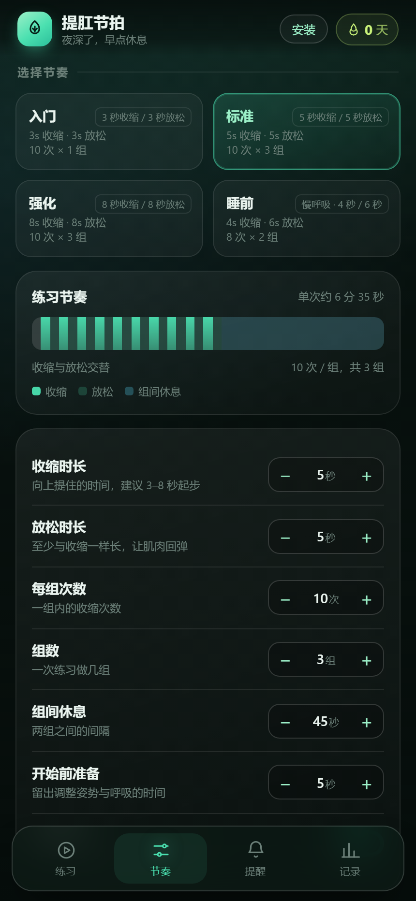
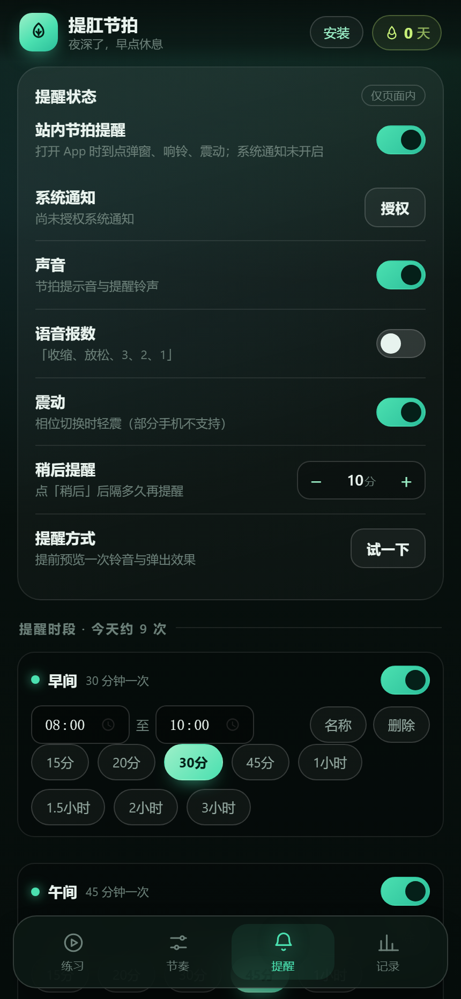
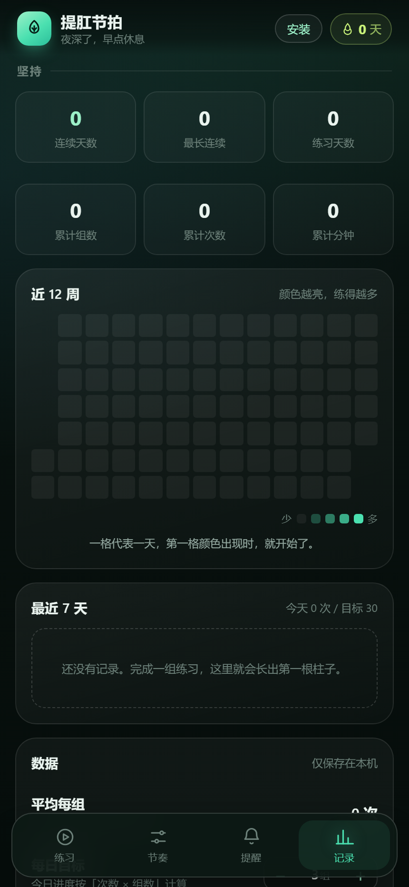

# 提肛节拍 · Kegel Rhythm

一个可以**自定义时间节奏**、提醒你按时做盆底肌（提肛）练习的移动端网页 App（PWA）。
纯前端、零依赖、数据只存在你自己的设备上。

| 练习 | 节奏 | 提醒 | 记录 |
| --- | --- | --- | --- |
|  |  |  |  |

## 它能做什么

- **自定义节奏**：收缩 / 放松各 1–30 秒、每组 1–30 次、1–10 组、组间休息 5–180 秒、
  开始前准备时间、收缩渐强。内置「入门 / 标准 / 强化 / 睡前」四套预设，改任何一项即变「自定义」。
- **引导练习**：全屏呼吸球跟着相位放大缩小，环形进度 + 秒级倒计时 + 次数圆点，
  收缩用青玉色、放松用雾蓝色；支持暂停 / 跳过 / 中途结束，屏幕常亮（Wake Lock）。
- **声音与震动**：Web Audio 合成的节拍提示音（不依赖音频文件）、可选中文语音报数
  （「收缩、放松、3、2、1」）、相位切换震动。
- **按时段提醒**：任意多个时段（默认早 / 午 / 晚），每个时段可设起止时间和间隔
  （15 分钟到 3 小时，或直接调）；到点弹层 + 铃声 + 震动 + 系统通知，支持「稍后提醒」。
- **关掉网页也能提醒**：一键导出 `.ics` 日历，把提醒交给手机自带日历，系统级闹钟，
  不耗电、不依赖浏览器（iPhone / Android 通用）。
- **记录与坚持**：今日次数 / 组数、连续天数、累计组数 / 次数 / 分钟、近 12 周热力图、
  最近 7 天柱状图、每日目标进度。
- **数据自持**：全部存 `localStorage`，可导出 / 导入 JSON 备份，可一键清空记录。
- **可安装**：PWA manifest + Service Worker，离线也能打开；支持添加到主屏幕、快捷方式直达「开始练习」。

## 本地运行

不要直接双击 `index.html`（`file://` 下 Service Worker 和部分通知 API 不可用）。
用任意静态服务器打开 `src/` 目录即可：

```bash
# 任选其一
python -m http.server 8777 --directory src
npx serve src -l 8777
```

然后访问 <http://127.0.0.1:8777/>。
Windows 下也可以双击根目录的 `serve.cmd`（需要已安装 Python）。

## 装到手机上

1. 把 `src/` 整个目录部署到任意支持 HTTPS 的静态托管（GitHub Pages / Netlify / Vercel /
   Cloudflare Pages 都可以，把 `src` 作为发布目录，无需构建）。
   - 快捷方式：`npx netlify deploy --dir=src --prod`，或把 `src` 拖进 Netlify Drop。
2. 手机浏览器打开部署后的网址：
   - **iPhone / Safari**：分享 → 「添加到主屏幕」。
   - **Android / Chrome**：菜单 → 「安装应用」或「添加到主屏幕」。
3. 首次进入跟着引导走一遍：定节奏 → 开提醒 → 导出日历提醒。

> 没有服务器也可以先用局域网：在电脑上跑上面的静态服务器，手机连同一个 Wi-Fi，
> 访问 `http://<电脑IP>:8777/`（注意：局域网 HTTP 下 Service Worker 不生效，属于浏览器限制）。

## 关于「关掉网页也能提醒」

| 方式 | 关掉网页 | 锁屏 | 说明 |
| --- | --- | --- | --- |
| 页面内提醒 | 否 | – | 打开 App 时最可靠，按秒调度 |
| 系统通知 | 否 | – | 页面在后台仍可尝试推送；浏览器可能节流 |
| 导出 `.ics` 到系统日历 | **是** | **是** | 推荐方案：由手机系统闹钟接管，完全可靠 |

这是纯网页方案（无服务器、无账号）的固有限制。如果你需要「关掉网页也精准响铃」且不想用日历，
下一步可以接入 Web Push（需要一台推送服务器）或做成原生 Android 前台服务版本。

## 目录结构

```
src/
  index.html              页面骨架（4 个 Tab + 引导层 + 弹层）
  css/styles.css          深玉色视觉系统，手机优先，支持深色/减少动效
  js/core.js              纯逻辑：时段调度、相位序列、统计、ICS 生成（可在 Node 中测试）
  js/app.js               应用层：状态、渲染、音频、提醒、会话引擎
  sw.js                   Service Worker（离线缓存）
  manifest.webmanifest    PWA 清单与快捷方式
  icons/                  应用图标（含 maskable）
test/
  core.test.js            18 个纯逻辑单元测试（node test/core.test.js）
  browser-check.js        无头 Chrome 端到端检查 + 截图（不依赖第三方库）
```

## 测试

```bash
# 纯逻辑单元测试（需要 Node 18+）
node test/core.test.js

# 端到端交互检查（需要本机 Chrome；先启动静态服务器）
node test/browser-check.js http://127.0.0.1:8777/index.html .shots
```

端到端脚本会检查：横向溢出、首次引导、四个页面的渲染、开始练习、暂停、结束记录、
预设与步进器、提醒间隔、提醒试响与「稍后」、统计页热力图、日历可生成、深链 `?go=start`、
Service Worker 注册，并输出各页面截图与 `report.json`。

## 快捷键（桌面 / 平板外接键盘）

- `空格`：暂停 / 继续；在完成页为「再来一组」
- `→`：跳过当前相位
- `Esc`：关闭弹层 / 结束练习确认

## 隐私与健康提示

- 没有任何网络请求，没有统计埋点，数据不出设备。
- 内容为一般健身信息，**不构成医疗建议**。若有盆腔疼痛、术后恢复、孕期或漏尿加重等情况，
  请先咨询医生或盆底康复治疗师。
- 参考：[NIDDK · Kegel Exercises](https://www.niddk.nih.gov/health-information/urologic-diseases/kegel-exercises)
